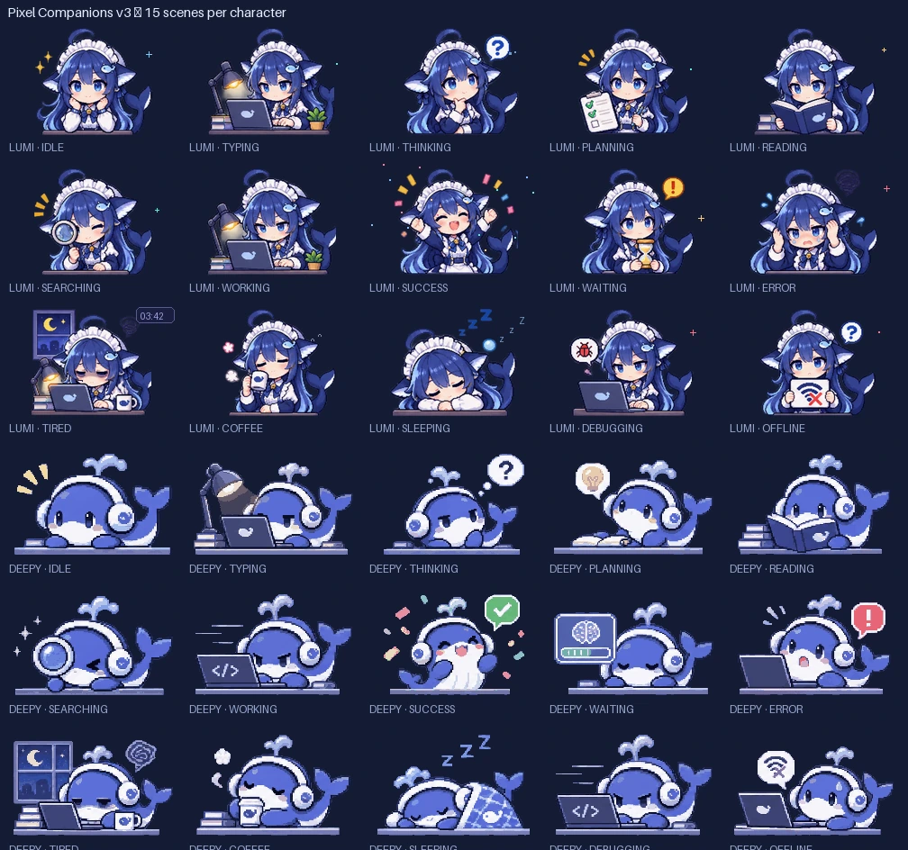

# DeepSeek Harness용 Pixel Companions

[English](README.md) | [中文](README.zh.md) | [Русский](README.ru.md) | [Tiếng Việt](README.vi.md) | [日本語](README.ja.md) | 한국어

저는 dsh 세션이 좀 더 사람 냄새 나기를 바라서 Pixel Companions를 만들었습니다. 이것은
[DeepSeek Harness](https://github.com/deepseek-ai/deepseek-harness) (dsh) 웹 GUI의 **전체
위에** 떠서 에이전트가 하는 일을 따라가는 애니메이션 픽셀 컴패니언입니다. 입력 중, 작업 중,
승인 대기, 완료, 수면 상태를 보여 줍니다. 저는 이것을 프레임 전체를 덮는 오버레이에
렌더링하므로 대화, 설정, 플러그인 등 모든 페이지에서 계속 보이고, 창 안 어디로든 끌어다
놓을 수 있습니다. 저는 이것을 평범한 옵트인 dsh **번들**로 유지했습니다. UI 포크도, 코어
패치도, 프롬프트·응답 가로채기도 없습니다. 저는 kappyra이고, 이것은 제가 dsh를 위해 만든
사이드 프로젝트입니다.



저는 두 캐릭터를 그렸고, 각각 15개의 애니메이션 장면이 있습니다:

- **Lumi** — 작업대에 앉은 픽셀 소녀.
- **Deepy** — 픽셀 고래.

**에셋.** Deepy는 제가 고른 v3 매트 픽셀 세트를 사용하고 Whale Girl은 팩의 v2 스타일을
유지합니다. 모든 스프라이트는 192×128이며 투명 배경입니다.

제 컴패니언은 공식 프레임 전체 `shell.overlay` 슬롯에 대한 브라우저 측 기여입니다.
`conversation.input.dock`의 숨겨진 브리지 항목이 세션 사실을 플러그인 자체 모듈 저장소에
게시하고, 오버레이가 이를 읽습니다. 톱니바퀴 버튼은 제가 이 브라우저의 `localStorage`에만
보관하는 작은 설정 팝오버를 엽니다(설정 참고).

## 기능

- **모든 페이지에 떠 있음.** 저는 오버레이를 모든 열 위에 두었으므로 대화, 설정,
  플러그인에서 컴패니언이 계속 보입니다. 입력창 옆에만 있는 것이 아닙니다.
- **어디로든 드래그.** 마우스 왼쪽 버튼, 터치, 펜으로 컴패니언을 창 안 어디로든 옮길 수
  있습니다. 저는 드래그와 클릭을 구분하도록 작은 드래그 임계값을 추가했습니다. 위치는
  뷰포트 안으로 제한되고, 창 크기가 바뀌면 다시 제한되며,
  `kappy.pixel-companions.ui.v1`에 `position: {x, y}`로 저장되어 새로고침 후에도
  유지됩니다(첫 드래그 전에는 `null`). 그 전까지 저는 입력창 영역 위의 오른쪽 아래에
  자동으로 배치하고 창 크기 변경을 따라갑니다.
- **모델 자체의 작업을 따름.** 저는 실행 중인 도구 호출, 스트리밍 중인 추론, 스트리밍 중인
  답변 텍스트, 실시간 스트림이 없는 실행 중 턴을 추적합니다. 프롬프트 텍스트나 사용자의
  입력은 절대 사용하지 않습니다. [docs/ko/scenes.md](docs/ko/scenes.md)를 참고하세요.
- **호버 메시지 입력창.** 저는 호버 메시지 입력창을 추가했습니다. 컴패니언이나 완료 보고서
  위에 마우스를 올려 현재 세션으로 보낼 메시지를 입력하고 전송할 수 있으며, 전송 후 입력창
  초안이 복원됩니다. 보고서가 보이는 동안에는 보고서 바로 아래에 쌓이고, 보고서가 닫히면
  컴패니언 아래로 이동합니다. 대화가 열려 있어야 하며, 드래그 중이거나 설정 패널이 열려
  있으면 숨겨집니다.
- **고정 완료 보고서.** 저는 보고서를 고정했습니다. 턴이 끝나면 최종 답변의 첫 줄과
  **자세히** 버튼이 컴패니언 아래에 남습니다. 컴패니언에 호버하거나 새 턴이 시작될 때까지
  유지됩니다. **자세히**는 전체 답변을 스크롤 가능한 패널에 일반 텍스트로 엽니다. 호버하면
  보고서가 닫히고, 패널은 ✕, Escape 또는 바깥 클릭으로 닫힙니다.
- **30개 애니메이션 WebP 장면**(캐릭터당 15개)과 모션 꺼짐용 정적 PNG. Deepy는 드래그하는
  동안 책상이 없는 `roaming` 애니메이션도 있습니다. 저는 스프라이트를 플러그인 자체 에셋
  라우트에서 제공하고 장면별로 가져오므로 JS 번들이 작게 유지됩니다.
- **6개 UI 언어.** 저는 캡션과 설정 라벨을 English, Русский, 中文, Tiếng Việt, 日本語,
  한국어로 번역했습니다. 첫 실행은 `navigator.language`가 일치하면 그 언어를 따르고
  아니면 영어를 사용합니다.
- **자체 설정.** 저는 모든 것을 펫의 톱니바퀴 팝오버에 보관합니다: 캐릭터, **크기**
  슬라이더(50–200%, 5% 단위, −/+ 버튼, 실시간 퍼센트, 50/100/150/200% 프리셋 칩), 언어,
  애니메이션 켜기/끄기, 표시 켜기/끄기, 위치 초기화, 15개 장면 수동 미리보기 그리드, 자동,
  닫기. 동일한 크기 컨트롤은 **설정 → 일반 → 컴패니언 크기**에도 등록되어 있습니다. 저는
  컴패니언을 실제 확대 픽셀 크기(100%에서 152×98)로 렌더링하므로 클릭 영역, 캡션/톱니바퀴,
  보고서/입력 열, 세부 정보 패널이 선택한 크기를 따라갑니다.
- **선택적 데스크톱 창.** 저는 같은 컴패니언을 데스크톱 창으로도 만들었습니다. 같은
  머신에서 프레임 없는 항상 위 Python 창으로 브라우저 밖에 실행할 수 있으며, localhost
  전용 브리지로 상태를 받습니다. 설정 행에서 미리보기를 보여 주고 실행 중이 아닐 때 시작
  명령을 경고와 함께 안내합니다. 기본값은 꺼짐입니다.
  [docs/ko/desktop.md](docs/ko/desktop.md)를 참고하세요.
- **구조적으로 안전.** 저는 오버레이 레이어를 클릭 통과로 만들었습니다. 컴패니언과
  톱니바퀴, 패널만 포인터 이벤트를 받습니다. 플러그인은 Host 코드를 갖지 않고, 자체 에셋
  라우트와 옵트인 localhost 데스크톱 브리지 외에는 네트워크 호출을 하지 않으며, 공개 슬롯
  props만 읽습니다.
- **옵트인 및 되돌리기 가능.** 설정 → 플러그인에서 제 플러그인을 비활성화하거나 번들을
  제거하면 UI가 원래대로 돌아갑니다.

## 요구 사항

- dsh 웹 프로필(`dsh web`) — 저는 공식 웹 클라이언트만 대상으로 합니다.
- `pnpm`이 `PATH`에 있어야 합니다. `dsh plugin`이 패키지 작업을 pnpm으로 넘기기
  때문입니다.
- 소스에서 다시 빌드할 때만 Node.js 22.6+가 필요합니다. 설치된 패키지에는 이미
  `client.js`가 들어 있습니다.

## 설치

저는 패키지를 미리 빌드된 번들로 배포합니다. `client.js`와 `assets/` 아래 에셋이
커밋되어 있어 설치에 빌드 단계가 필요 없습니다.

### 로컬 체크아웃에서 설치

```sh
git clone https://github.com/kappyra/dsh-pixel-companions.git
cd dsh-pixel-companions
dsh plugin --profile web add link:"$PWD"
```

`link:`는 프로필이 작업 복사본을 가리키게 하므로, 이후 `assets/`나 `src/` 수정 사항
(`npm run build` 후)이 즉시 제공됩니다.

### Git 주소 또는 tarball에서 설치

```sh
dsh plugin --profile web add github:kappyra/dsh-pixel-companions
# or, after `npm pack` in the checkout:
dsh plugin --profile web add /path/to/dsh-pixel-companions-0.1.0.tgz
```

그다음 **웹 페이지를 새로고침**합니다. 번들을 추가하면 프로필에서 활성화되고, 컴패니언이
모든 페이지의 오른쪽 아래 근처에 나타나며 페이지 탐색 후에도 유지됩니다. 클라이언트 HMR
전송이 보통 1~2초 안에 새 번들로 교체하므로 새로고침은 항상 안전합니다.

전체 흐름(플러그인 페이지, 활성화, 비활성화, 제거, 문제 해결):
[docs/ko/installation.md](docs/ko/installation.md). 저는 드래그, 호버 메시지 입력창, 고정
보고서와 상세 정보, 크기, 언어, 데스크톱 창 같은 일상 사용법을
[docs/ko/usage.md](docs/ko/usage.md)에 정리했습니다.

## 설정

저는 모든 설정을 컴패니언이나 톱니바퀴 버튼(⚙)에서 여는 패널에 보관합니다:

| 컨트롤 | 기능 | 저장 위치 |
| --- | --- | --- |
| 캐릭터 | Lumi 또는 Deepy | `kappy.pixel-companions.ui.v1` |
| 크기 | 50–200% 슬라이더, 5% 단위, −/+ 버튼, 실시간 값, 50/100/150/200% 프리셋 칩; 스프라이트는 실제 픽셀 크기로 렌더링 | 동일 키 |
| 컴패니언 크기(설정 → 일반) | 톱니바퀴 팝오버와 같은 슬라이더, −/+ 버튼, 값, 프리셋; 두 곳 모두 공유 환경설정을 편집하고 동기화 유지 | 동일 키 |
| 언어 | English, Русский, 中文, Tiếng Việt, 日本語, 한국어 | 동일 키 |
| 애니메이션 | 애니메이션 WebP 또는 정적 PNG | 동일 키 |
| 표시 | 컴패니언 표시 또는 숨김 | 동일 키 |
| 데스크톱 창 | 선택적 데스크톱 창으로 장면 미러링; 상태 꺼짐 / 실행 중이 아님 / 연결됨 | 동일 키 |
| 위치 초기화 | 컴패니언을 자동 오른쪽 아래 기본 위치로 복귀 | 동일 키 |
| 테스트 장면 | 15개 장면 중 하나를 강제 표시하거나 자동으로 복귀(**자동**) | 세션 상태에만 |
| 닫기 | 패널 닫기; **Escape** 또는 바깥 클릭으로도 닫힘 | — |

저는 패널을 컴패니언에 고정하고 위/아래로 자동 전환하며 뷰포트 안으로 제한합니다.
환경설정과 드래그한 위치는 브라우저와 프로필 단위로 저장되며 Host 설정 서비스에는 기록되지
않습니다. 플러그인은 별도 설정 페이지를 추가하지 않고, 크기 행이 설정 → 일반에 나타납니다.

## 데스크톱 창(선택 사항)

저는 같은 컴패니언을 데스크톱 창으로도 만들었습니다. 같은 머신에서 프레임 없는 항상 위,
픽셀 단위 투명 창으로 브라우저 밖에 실행할 수 있습니다. 기본값은 꺼짐입니다.

```sh
sudo apt install python3-gi gir1.2-gtk-3.0 python3-cairo
python3 -m pip install --user Pillow
python3 desktop/companion.py        # or ./desktop/run.sh
```

톱니바퀴 패널에서 **데스크톱 창**을 체크하세요. 행에는 **연결됨**, **실행 중이 아님**,
**꺼짐**이 표시됩니다. 장면 id, 캐릭터, 크기, 모션 플래그만 localhost 브리지를 지나며,
프롬프트 텍스트, 초안, 메시지, 세션 id, 파일 경로, 모델 출력은 전혀 지나지 않습니다.
[docs/ko/desktop.md](docs/ko/desktop.md)를 참고하세요.

## 장면

| 관찰된 신호 | 장면 | 정직한 의미 |
| --- | --- | --- |
| 프롬프트 제출됨(`input.phase` = sending/submitting/adjudicating) | `typing` | 메시지가 제출되는 중 |
| 도구 호출 실행 중 | `working` | 도구가 실행 중 |
| 어시스턴트가 추론 스트리밍 중 | `thinking` | 모델이 추론 중 |
| 어시스턴트가 답변 텍스트 스트리밍 중 | `typing` | 모델이 답변을 작성 중 |
| 턴 실행 중, 실시간 스트림 없음(요청 왕복 중) | `thinking` | 모델을 기다리는 중 |
| 실시간 신호 없이 75초 초과 실행 | `tired` | 긴 작업, 모델 피로가 아님 |
| 실시간 신호 없이 180초 초과 실행 | `coffee` | 표시용일 뿐 |
| 승인/질문 대기 | `waiting` | 사용자를 기다림 |
| `promptError`, `lastAgentError` 또는 `openState = error` | `error` | 실제 오류 신호 |
| 실행 → 오류 없이 중지 | `success`(고정) | 컴패니언에 호버하거나 새 턴이 시작될 때까지 보고서와 함께 유지; 취소가 포함될 수 있음 |
| 110초 동안 활동 없음 | `sleeping` | 표시 전용 유휴 타이머 |
| 그 외 | `idle` | — |

저는 규칙을 언어와 무관하게 만들었습니다. 컴패니언 아래 캡션만 현지화됩니다. `thinking`은
어시스턴트가 추론 중이라는 뜻이며, 입력창에 초안을 쓰는 것은 아무것도 바꾸지 않습니다.
`planning`, `reading`, `searching`, `debugging`, `offline`은 클라이언트가 타입이 있는
신호를 제공할 때까지 **수동 미리보기 전용**이며, 플러그인은 프롬프트 단어에서 이를 추측하지
않습니다. 전체 규칙: [docs/ko/scenes.md](docs/ko/scenes.md).

## 호환성

저는 실제 dsh `0.2.2-alpha.2` 웹 프로필에서 검증했습니다. 번들이 설치되고, Client 모듈이
Harness 모듈 로더를 통해 로드되며, 항목이 `shell.overlay`(컴패니언)와
`conversation.input.dock`(숨겨진 브리지)에 등록되고, 제공된 번들 바이트가 저장소와
일치하며, 컴포넌트가 실제 슬롯 props로 렌더링됩니다. 저는 의존하는 정확한 API,
브리지 → 오버레이 데이터 흐름, 6개 언어 사전, 선택적 데스크톱 브리지를
[docs/ko/compatibility.md](docs/ko/compatibility.md)에 정리했습니다. 시각적
확인(밝은/어두운 테마, 드래그 감각, 정확한 배치)은 직접 창에서 확인하실 몫입니다.

## 개발

```sh
npm install            # esbuild, dev-only
npm run build          # build the asset manifest, then bundle client.js
npm test               # unit tests (Node 22.6+)
```

브라우저 코드: `src/client/bridge.ts`(사실 저장소), `Pet.tsx`(오버레이, 드래그와 roaming,
숨겨진 브리지, 호버 입력창, 보고서), `state.ts`(장면 규칙), `signals.ts`와
`asset-url.ts`(순수 헬퍼와 에셋 라우트 해석), `text.ts`(6개 언어), `desktop.ts`(선택적
데스크톱 브리지). 저는 파이프라인, 패키징, 구조를
[docs/ko/development.md](docs/ko/development.md)에 정리했습니다.

## 라이선스와 에셋

- 저는 **플러그인 코드를 MIT**로 배포합니다 — [LICENSE](LICENSE)를 참고하세요.
- 저는 이 프로젝트를 위해 `assets/`, `source-art/`, `demo/`, 그리고 플러그인이 제공하는
  사본에 있는 **마스코트 에셋**을 만들었습니다. 이 에셋은 프로젝트와 함께 배포됩니다.
  코드의 MIT 허가에는 포함되지 않으며, 저는 그 권리를 보유합니다.
  [ASSETS_NOTICE.md](ASSETS_NOTICE.md)를 참고하세요.
- DeepSeek과 DeepSeek Harness는 각 소유자의 상표입니다. 이는 비공식 커뮤니티
  플러그인이며 DeepSeek과 제휴하거나 그 승인을 받지 않았습니다. Harness가 문서화한 공개
  플러그인 API만 사용합니다.

## 문제 해결

| 증상 | 확인 사항 |
| --- | --- |
| 어디에도 컴패니언이 없음 | 설정 → 플러그인: 번들이 활성화되어 있나요? 페이지를 새로고침하세요. 열린 대화가 필요하지는 않습니다. |
| 컴패니언은 보이지만 멈춤 | 정적 PNG가 선택되었거나(애니메이션 꺼짐) OS가 동작 줄이기를 요청했을 수 있습니다. |
| 드래그해도 컴패니언이 움직이지 않음 | 놓기 전에 몇 픽셀 움직이고(드래그 임계값이 있음) 빈 오버레이가 아니라 스프라이트 자체를 드래그하세요. |
| 창 크기 조절이나 모니터 변경 후 컴패니언이 화면 밖에 있음 | 톱니바퀴 → **위치 초기화**; 자동 오른쪽 아래 기본 위치로 돌아갑니다. |
| 스프라이트가 너무 크거나 작음 | 톱니바퀴 팝오버나 설정 → 일반 → **컴패니언 크기**에서 **50/100/150/200%** 프리셋 칩을 누르거나 **크기** 슬라이더(50–200%)를 드래그하세요. 저장된 위치는 자동으로 다시 제한되며, **위치 초기화**가 자동 오른쪽 아래 위치를 복원합니다. |
| 크기 컨트롤을 찾을 수 없음 | **설정 → 일반 → 컴패니언 크기**와 컴패니언의 ⚙ 팝오버에 있습니다. 두 곳 모두 같은 환경설정을 편집합니다. 어디에도 없으면 강제 새로고침이 필요합니다(페이지가 오래된 클라이언트 번들을 실행 중). |
| 언어가 잘못됨 | 톱니바퀴 → **언어**. 첫 실행은 브라우저 언어를 따르고, 아니면 영어입니다. |
| 설정 팝오버가 잘림 | 패널이 전환되고 뷰포트 안으로 제한됩니다. **위치 초기화** 후 창 크기를 알려 주세요. |
| 데스크톱 창이 계속 offline이거나 불투명한 상자임 | 페이지가 열려 있고 **데스크톱 창**이 체크되어 있는지 확인하세요. 투명도를 위해 `python3-cairo`를 설치하고, `curl http://127.0.0.1:37421/health`를 확인하세요. [docs/ko/desktop.md](docs/ko/desktop.md)를 참고하세요. |
| 에셋 변경 후 스프라이트가 오래되었거나 404 발생 | `npm run build`를 실행하세요. `?v=` 콘텐츠 해시가 각 스프라이트 URL에 포함되어 있습니다. 그다음 페이지를 새로고침하세요. |
| `client.js`를 불러오지 못함 | 프로필이 패키지를 제공해야 합니다. `dsh plugin --profile web add`를 다시 실행하고 `$DSH_HOME/profiles/web/.plugin-manager/logs/` 아래 pnpm 로그를 확인하세요. |

더 많은 내용은 [docs/ko/troubleshooting.md](docs/ko/troubleshooting.md)를 참고하세요.
